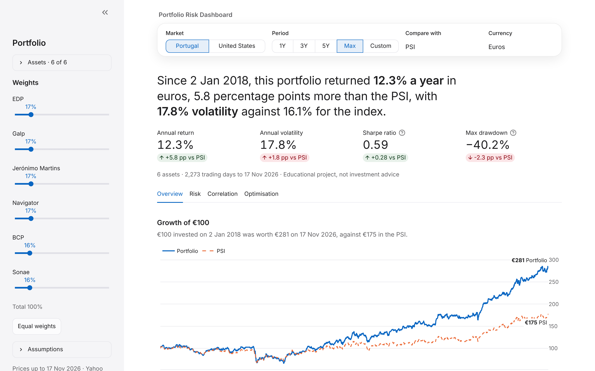

# Portfolio Risk Dashboard

[](https://github.com/rodrigomvp/portfolio-dashboard/actions/workflows/tests.yml)
[](https://github.com/rodrigomvp/portfolio-dashboard/actions/workflows/update-data.yml)

Interactive dashboard to analyse the risk and return of a stock portfolio: returns, volatility, correlations, drawdowns, risk-adjusted performance, Value-at-Risk and mean-variance optimisation.

**Live demo:** _link added after deployment_ · Development history: [ROADMAP.md](ROADMAP.md)



## Why this project

Most portfolio dashboards stop at descriptive charts. This one aims to support a decision: *given these assets, how should I allocate, and what risk am I taking?*

## Features

| Area | Status |
|---|---|
| Daily price ingestion (yfinance → SQLite, incremental updates) | ✅ Done |
| Returns, volatility, Sharpe, max drawdown, correlation, beta | ✅ Done |
| Interactive Streamlit dashboard | ✅ Done |
| Historical & parametric VaR / CVaR | ✅ Done |
| Efficient frontier, min-variance & max-Sharpe portfolios | ✅ Done |
| Two markets (Lisbon + New York) in euros, choice of benchmark (PSI, S&P 500, Nasdaq-100) | ✅ v1.1 |
| Market switch: Portugal vs PSI in EUR; 10 US stocks from 9 sectors vs S&P 500 / Nasdaq-100 in USD, with an option to show them in EUR | ✅ v1.2 |
| Daily data refresh (GitHub Action → CSV snapshot) and deployment on Streamlit Community Cloud | ✅ v1.3 |

## Project structure

```
portfolio-dashboard/
├── app/streamlit_app.py        # Dashboard (UI only, no business logic)
├── config/settings.yaml        # Markets, tickers, benchmarks, dates, risk-free rates
├── data/prices.csv             # Price snapshot, committed daily (the SQLite file is git-ignored)
├── scripts/update_data.py      # CLI entry point to refresh prices
├── src/portfolio/
│   ├── config.py               # Loads settings.yaml
│   ├── db.py                   # SQLite schema and read/write helpers
│   ├── ingest.py               # Downloads prices from yfinance
│   ├── snapshot.py             # SQLite ⇄ CSV snapshot
│   ├── fx.py                   # Currency conversion
│   ├── metrics.py              # Return and risk metrics
│   ├── risk.py                 # VaR / CVaR
│   └── optimization.py         # Mean-variance optimisation
├── notebooks/                  # Data quality, metrics and US data checks
├── tests/                      # pytest unit tests
└── .github/workflows/          # tests on every push; daily data refresh
```

Design principle: **all calculations live in `src/portfolio/` and are unit-tested; the Streamlit app only displays them.**

## Getting started

```bash
python -m venv .venv
source .venv/bin/activate        # Windows: .venv\Scripts\activate
pip install -r requirements.txt
pip install -e .

streamlit run app/streamlit_app.py   # builds data/prices.db from data/prices.csv on first run
pytest

python scripts/update_data.py        # optional: fetch the newest days from Yahoo Finance
python scripts/update_data.py --full # optional: download the whole history again
```

The repository already contains the prices up to the last weekday, so the app runs without downloading anything.

## Design

The dashboard answers one question: *is this portfolio worth the risk it takes compared with its market index?*
The answer is a plain sentence with the actual numbers, and it is the largest text on the page; the app name stays small and every chart below supports that sentence.

- **Choose the view, build the portfolio.** A floating context bar at the top holds what changes *what you are looking at*: market, period, benchmark and currency. The sidebar only holds what *builds* the portfolio: assets, weights and assumptions. On a phone the bar sits at the top of the page, so nothing important hides behind the collapsed sidebar.
- **Glass only where it belongs.** The context bar is the one translucent surface (backdrop blur and a hairline edge, after Apple's Liquid Glass): it floats above content that scrolls beneath it, and charts, tables and text never get glass. With *Reduce transparency* or *Increase contrast* turned on in the system, the bar becomes opaque with a stronger border. Text on the bar keeps at least 6.9:1 contrast even with a coloured chart line passing underneath.
- **A quiet scorecard.** Return, volatility, Sharpe ratio and max drawdown sit in one row without boxes, each with its difference from the index.

- **Colour has one meaning.** Blue is the portfolio, and also the accent of every control that changes it. Orange is the index, and the index line is always dashed so the two series never depend on colour alone. Green and red appear only on deltas against the index, always with an arrow.
- **Contrast.** Text is at least 4.5:1 and chart lines at least 3:1 against the background, in both light and dark mode (tokens in `.streamlit/config.toml` and at the top of `app/streamlit_app.py`).
- **Every chart has a one-sentence summary** with real values (dates, percentages), so the main message does not depend on reading the chart.
- **One market at a time.** A segmented control switches between Portugal and the United States, so each portfolio is compared with its own index (comparing Nvidia with the PSI says nothing). Each market keeps its own assets, weights and benchmark when you switch back and forth. US figures are in dollars by default; *Show in euros* converts them to what an investor in euros would have earned.
- **Familiar controls.** Quick period ranges (1Y, 3Y, 5Y, Max, Custom) as in a stocks app, weights as sliders with a one-click reset to equal weights, and assumptions (risk-free rate) tucked into an expander.
- **Charts that answer their own question.** Lines end with direct labels (e.g. *€281 Portfolio*), and drawdowns are drawn as a filled "underwater" area with the index dashed on top.
- **System font** (San Francisco on Apple devices, Segoe UI on Windows) and tabular figures so numbers do not jump while sliders move.

Guided by Apple's Human Interface Guidelines (accessibility, color, typography, layout, branding, charts, Liquid Glass).

## Methodology

### Data
- Source: Yahoo Finance via yfinance, adjusted daily closes (dividends and splits), Jan 2018 onwards.
- Pipeline: every weekday at 22:17 UTC, after the New York close, a GitHub Action downloads the whole history again, stores it in SQLite and commits it as `data/prices.csv` if anything changed. The deployed app loads that CSV into SQLite when it starts, so it never calls Yahoo itself. The CSV is sorted by ticker and date, so a normal day adds a few lines to the git diff. The history is downloaded again in full, not just the newest days, because Yahoo recalculates every past adjusted price after each dividend: an incremental update would keep older prices from before the adjustment next to newer prices from after it, and every return across that dividend would be wrong.
- Currency: each market is shown in its own currency. With *Show in euros*, US prices are converted with the daily EUR/USD rate (`EURUSD=X`), so returns and volatility are those of a euro investor and include currency risk. Yahoo's daily rate is taken at the start of the London day, so each New York close uses Yahoo's next-day value (`fx.to_new_york_close`); without this, currency moves would land one day late (see `notebooks/03_us_data.ipynb`).
- Risk-free rate: one per currency, used in the Sharpe ratio — 3-month Euribor for EUR, 3-month US Treasury yield for USD (values and dates in `config/settings.yaml`). When US figures are shown in euros, the EUR rate is used.
- Quality checks: see `notebooks/01_data_quality.ipynb`.
- Missing data and calendars: in v1.0 (Lisbon only) the PSI index had no price on 12 of 2,272 dates (0.53%), and those dates were dropped. With two exchanges, Lisbon and New York close on different holidays, and dropping every incomplete date would remove about 4% of the data. Since v1.1 a closed market keeps its last price for up to 3 days, which is how funds value their holdings every day. Annualised figures use the number of observations per year actually in the data instead of a fixed 252.
- Outliers: 4 daily moves above 15% (COVID crash, Pfizer vaccine announcement, Galp's Namibia discovery, Jeronimo Martins H1 2024 results). All are real events and are kept, since removing them would understate risk.

## Limitations

- **Different closing times (v1.1 only).** Lisbon closes at 16:30 and New York at 21:00 (Lisbon time), so daily correlations between the two markets look lower than they are. Since v1.2 each market is analysed on its own, so this no longer affects the dashboard; it will matter again for a future mixed-market mode.
- **Small universes.** 6 Portuguese and 10 US stocks, chosen today: companies that were removed or went bankrupt since 2018 are not included (survivorship bias).
- **Price indices vs. adjusted prices.** Stock prices include dividends, but the PSI, S&P 500 and Nasdaq-100 are price indices. Comparisons with the index therefore favour the portfolio by roughly the index dividend yield.

- **The past does not predict the future.** Every figure is computed on 2018–2026 data. The optimiser shows how much that matters: highest-Sharpe weights fitted on everything except the last 12 months, then held for those 12 months, returned 34.8% in Portugal (equal weights: 25.7%) but −1.3% in the US (equal weights: 17.2%), as of Nov 2026 (*Optimisation* tab, "Would it have worked?"). Optimal weights are an analysis of the past, not a forecast.
- **Normality in parametric VaR.** Parametric VaR assumes normally distributed daily returns, but real returns have fat tails (excess kurtosis of about 11 in the Portuguese and 15 in the US equal-weight portfolio). At 99%, the equal-weight portfolio lost more than its parametric VaR on 38 days in Portugal and 46 in the US, against about 23 and 22 expected. That is why historical VaR and CVaR are shown next to it.
- **Data quality of yfinance.** Yahoo Finance is free and unofficial: there is no guarantee of completeness, and the API can change or limit requests without notice. Known issues, all handled: the PSI has no price on 12 dates since 2018; the daily EUR/USD rate is stamped one day early (see Methodology); adjusted prices change after every dividend (hence the full daily download). A production system would use a licensed data provider.

## Tech stack

Python · pandas · NumPy · SciPy · SQLite · Plotly · Streamlit · pytest · GitHub Actions

## Disclaimer

Educational project. Nothing here is investment advice.
